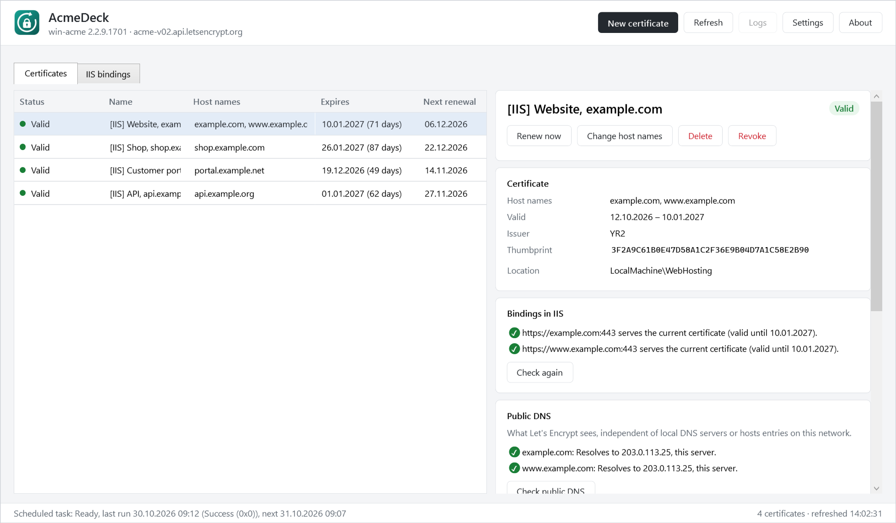
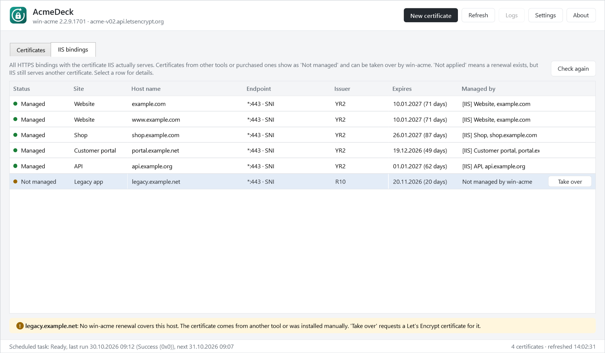
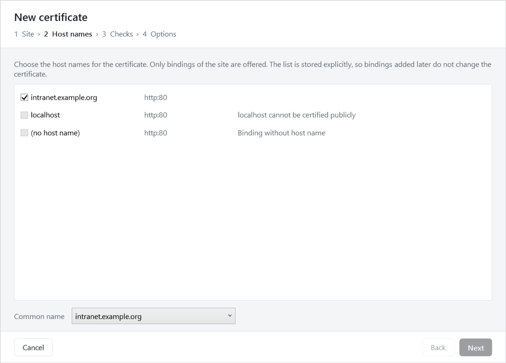

# AcmeDeck – free Windows GUI for win-acme

**Request, renew and monitor Let's Encrypt SSL/TLS certificates for IIS on Windows Server,
with a graphical interface instead of the command line.**

[**Download the installer**](https://github.com/MathiasHitz/AcmeDeck/releases/latest) ·
Windows x64 · no .NET runtime required · MIT License



[win-acme](https://www.win-acme.com/) does the actual work: ordering, validation,
storing, binding and the daily renewal task. AcmeDeck gives it a point-and-click
interface and adds the checks that are missing when something silently goes wrong,
for example a certificate that was issued but never reached the IIS binding.

AcmeDeck is a free alternative for managing IIS certificates with win-acme. It can take
over bindings whose certificates were created with other tools, for example
Certify The Web.

> AcmeDeck is an independent project and not affiliated with win-acme, Let's Encrypt or
> Certify The Web. All product names are trademarks of their respective owners.

## Features

- **Overview** of all win-acme renewals with expiry, next renewal, last run and status
- **New certificate wizard**: pick an IIS site, tick host names, check, request.
  Always stores an explicit site id and host list, so a binding added later cannot
  sneak into the next order.
- **Staging test**: runs the full validation against the Let's Encrypt staging
  environment without touching IIS and without counting against rate limits.
- **IIS bindings view**: every HTTPS binding with the certificate it actually serves.
  Certificates from other tools or purchased ones can be
  **taken over** by win-acme with one click.
- **Health checks** on start:
  - wacs.exe running from a user profile folder (Desktop, Downloads)
  - scheduled task missing, disabled, failing or pointing to another wacs.exe
  - no e-mail notification configured
  - several renewals managing the same certificate or the same host name
  - renewals without site or host filter
  - host names Let's Encrypt will reject (`localhost`, IP addresses, `.local` …)
  - bindings that win-acme leaves unchanged: different capitalization of the same host
    name, or the IIS Central Certificate Store option
- **Binding check**: connects to each HTTPS binding with SNI and compares the served
  certificate with the one win-acme issued last. Certificates that were issued but are
  not in use show as **Not applied** instead of looking valid.
- **Public DNS check** via DNS over HTTPS, independent of local DNS servers or hosts
  entries. Detects names that only resolve through a wildcard record at the DNS provider.
- **Notification settings** for win-acme's settings.json with a test e-mail
- **Log viewer** with a warnings-and-errors filter

## Screenshots

**IIS bindings** – every HTTPS binding with the certificate IIS actually serves.
Certificates from other tools can be taken over with one click.



**New certificate** – pick the site and host names; names Let's Encrypt would reject are
excluded up front.



## Requirements

- Windows Server 2016 or later (or Windows 10/11) with IIS
- win-acme 2.2.x, x64 (bundled with the installer or installed separately)
- Administrator rights (IIS configuration, machine certificate store, Task Scheduler)

No .NET runtime is needed, the application is published self-contained.

## How it works

AcmeDeck never writes win-acme's renewal files. It reads them from
`%ProgramData%\win-acme\<ACME server>\*.renewal.json` and runs `wacs.exe` unattended
for every change (`--source iis`, `--renew --id`, `--cancel --id`, ...). The output is
shown live. Whether a run succeeded is judged by what win-acme recorded in the renewal
history, not only by the exit code.

The only file AcmeDeck edits is the `Notification` section of win-acme's
`settings.json` (with a timestamped backup), and its own settings in
`%ProgramData%\AcmeDeck\settings.json`.

Online checks send host names to `dns.google` and ask `api.ipify.org` for the public
IP of the server. They can be switched off in the settings.

## Taking over existing certificates

A checklist for moving a server from another certificate tool to win-acme. Each point
is a pitfall that caused real failures.

**Before you start**

1. **Port 80 must be reachable from the whole internet.** Let's Encrypt validates from
   several locations worldwide. A firewall that only allows certain countries or
   addresses makes validation fail. Use the staging test in the wizard first.
2. **Every host name needs its own public DNS record pointing to the server.** A
   wildcard record at the DNS provider can make a name resolve to a different machine,
   and local resolvers may show something else than the internet sees. The public DNS
   check in AcmeDeck looks at what Let's Encrypt sees.
3. **Stop or uninstall the previous tool first.** Otherwise it may keep renewing and put
   its own certificate back into the binding. Its certificates stay valid until they
   expire, but are no longer renewed, so take every binding over before that date.

**Installing**

4. Install AcmeDeck with the bundled win-acme, or point it to an existing win-acme in
   the settings. AcmeDeck warns if win-acme runs from a user profile folder.
5. Configure the e-mail notification and send a test message.

**Taking over**

6. Open the **IIS bindings** tab and fix every warning *before* taking anything over:
   - bindings of the same host name with different capitalization (win-acme 2.2.9 then
     reports success without updating the HTTPS binding) — use lower case everywhere
   - bindings with "Use Centralized Certificate Store" — clear the option in IIS Manager
   - host names that cannot be certified, such as `localhost`
7. Take the bindings over one by one and check that each one turns to **Managed**.
8. When done, no binding should show **Not managed** or **Not applied**.

## Building

Requires the .NET 10 SDK and, for the installer, Inno Setup 6.

```powershell
dotnet build AcmeDeck.sln
```

Installer (self-contained single file, optionally with win-acme bundled):

```powershell
.\setup\build.ps1 -WinAcmeVersion v2.2.9.1701
```

When win-acme is bundled, it is installed to `C:\Program Files\AcmeDeck\win-acme` and
deliberately left in place on uninstall, because the scheduled task points to it.
win-acme is licensed under the Apache License 2.0; its license file is part of the
release archive and is installed with it.

## Author

AcmeDeck was created by Mathias Hitz.

## Support

If AcmeDeck saves you time or a license fee, you can buy me a coffee via
[PayPal](https://www.paypal.com/paypalme/usterix). Thank you!

## License

MIT, see [LICENSE](LICENSE).
